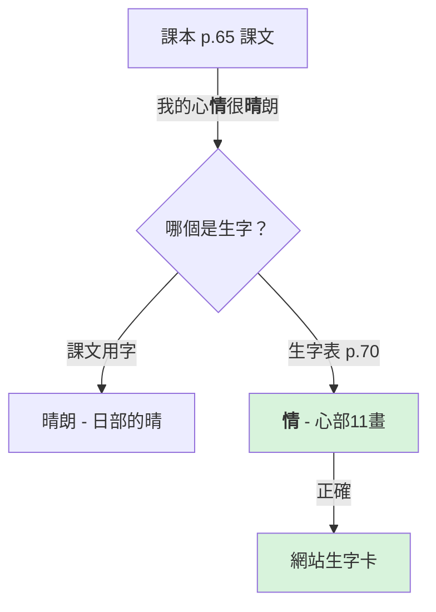
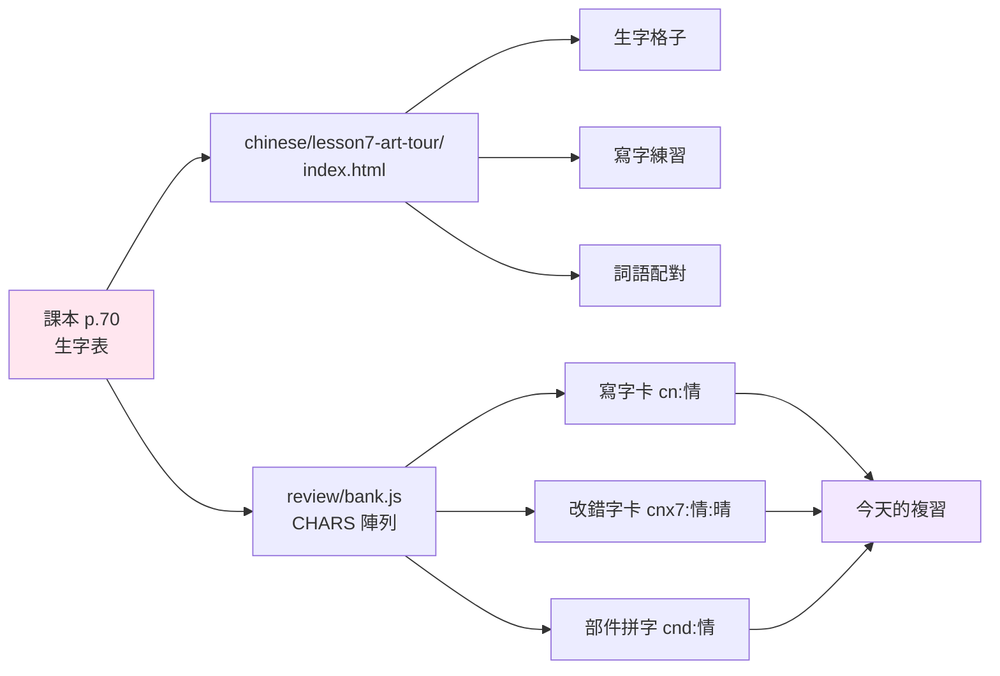
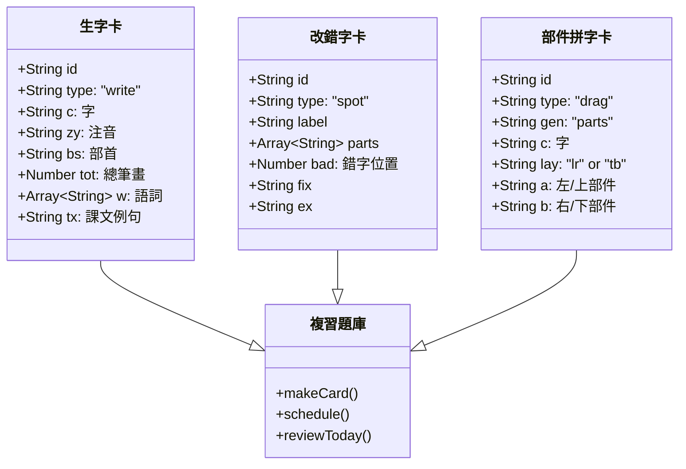

# 國語第七課「到此『藝』遊」- 教科書對照說明

## 📖 課本來源
南一版國語四上（第七冊）課本 pp.64-71

## 修正記錄（2026-11-13）

### 生字修正：晴 → 情

根據課本 p.70 生字表，第七課教的生字是「情」（心部，11畫），而非「晴」（日部，12畫）。

### 數據流程

### 15 個生字對照表

| 生字 | 注音 | 部首 | 總筆畫 | 課文例句 | 課本頁碼 |
|------|------|------|--------|----------|----------|
| 育 | ㄩˋ | 肉(⺼) | 8 | 戶外教育日 | p.65 |
| **情** | **ㄑㄧㄥˊ** | **心(忄)** | **11** | **我的心情很晴朗** | **p.65** |
| 陶 | ㄊㄠˊ | 阜(⻖) | 11 | 傳習所介紹陶器 | p.65 |
| 目 | ㄇㄨˋ | 目 | 5 | 令人目不轉睛 | p.65 |
| 芒 | ㄇㄤˊ | 艸(艹) | 9 | 閃著七彩光芒 | p.65 |
| 返 | ㄈㄢˇ | 辵(⻌) | 8 | 讓我流連忘返 | p.65 |
| 劇 | ㄐㄩˋ | 刀(刂) | 15 | 到劇場觀賞 | p.66 |
| 斗 | ㄉㄡˇ | 斗 | 4 | 又唱又跳、翻跟斗 | p.66 |
| 索 | ㄙㄨㄛˇ | 糸(糹) | 10 | 走在細細的鋼索上 | p.66 |
| 禁 | ㄐㄧㄣ | 示(礻) | 13 | 大家不禁捏一把冷汗 | p.66 |
| 渡 | ㄉㄨˋ | 水(氵) | 13 | 到渡船頭坐木船 | p.67 |
| 念 | ㄋㄧㄢˋ | 心 | 8 | 挑著喜歡的紀念品 | p.68 |
| 麵 | ㄇㄧㄢˋ | 麥 | 20 | 五顏六色的捏麵人 | p.68 |
| 統 | ㄊㄨㄥˇ | 糸(糹) | 12 | 許多傳統文化 | p.69 |
| 值 | ㄓˊ | 人(亻) | 10 | 值得細細品味 | p.69 |

**粗體**標示為本次修正項目。

### 卡片結構

### 修正後檔案

1. `chinese/lesson7-art-tour/index.html`
   - CHARS 陣列：晴 → 情
   - BSFORM：日 → 心(忄)
   - 來源註記更新

2. `review/bank.js`
   - CHARS[line 1188]：晴 → 情
   - LOOK[line 1238]：改錯字配對更新
   - PARTS[line 1647]：部件拼字更新（日青 → 忄青）

3. 已刪除：`chinese/lesson7-art-tour/lesson7.md`

## 測試項目

- [待測試] 390px 寬度響應式顯示
- [待測試] 生字格子正確顯示「情」
- [待測試] 寫字練習功能正常
- [待測試] 詞語配對遊戲正常
- [待測試] 複習卡片生成無誤
- [待測試] 無重複 card ID
