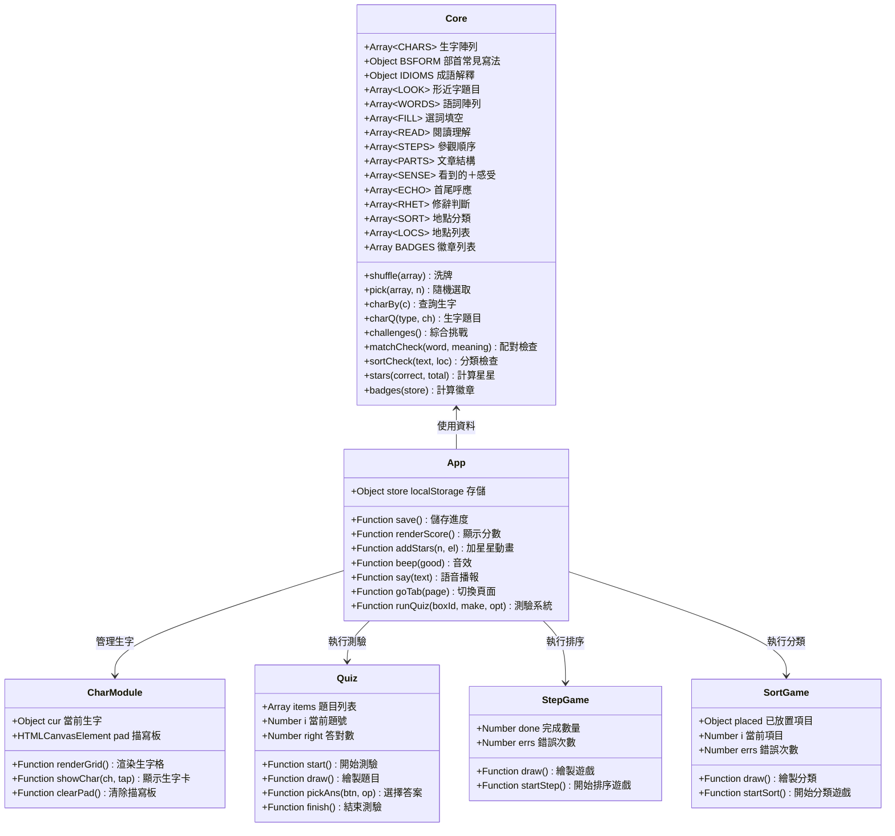
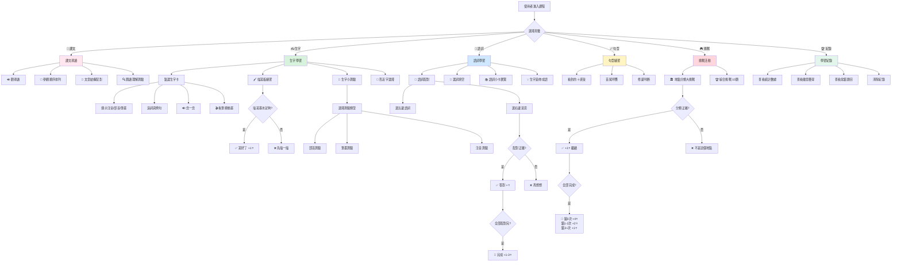
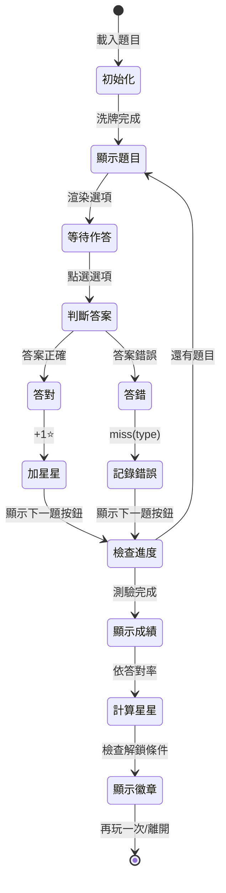
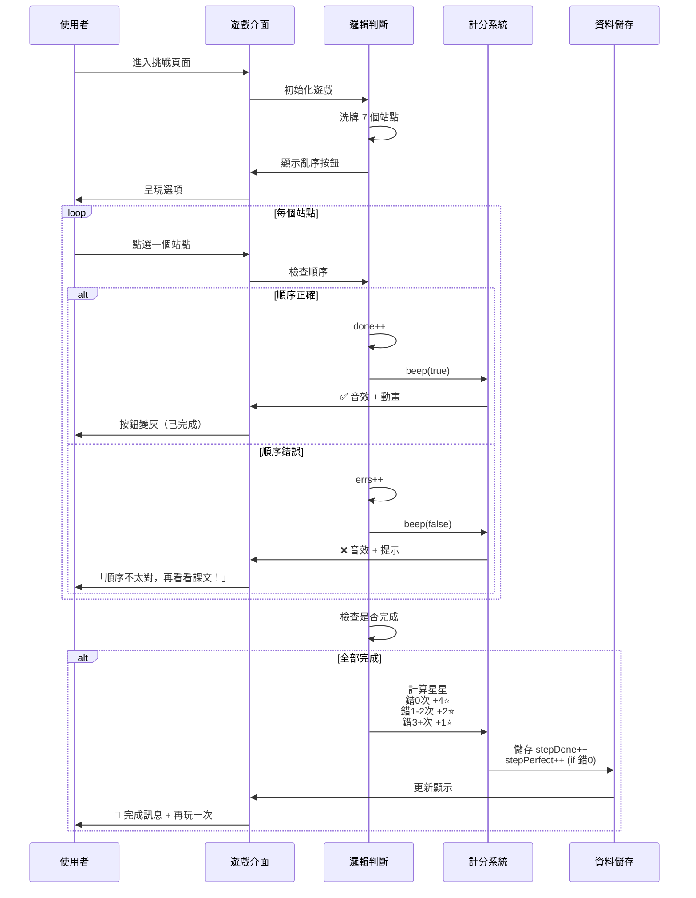
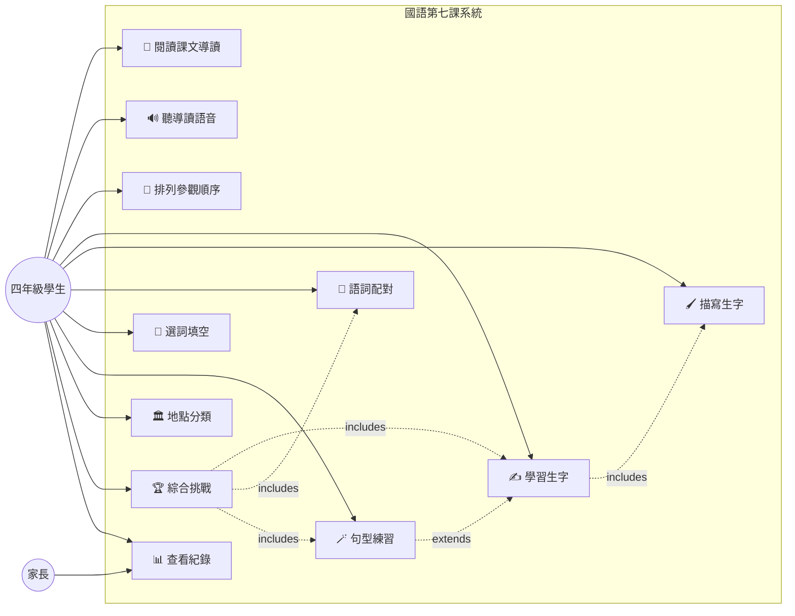
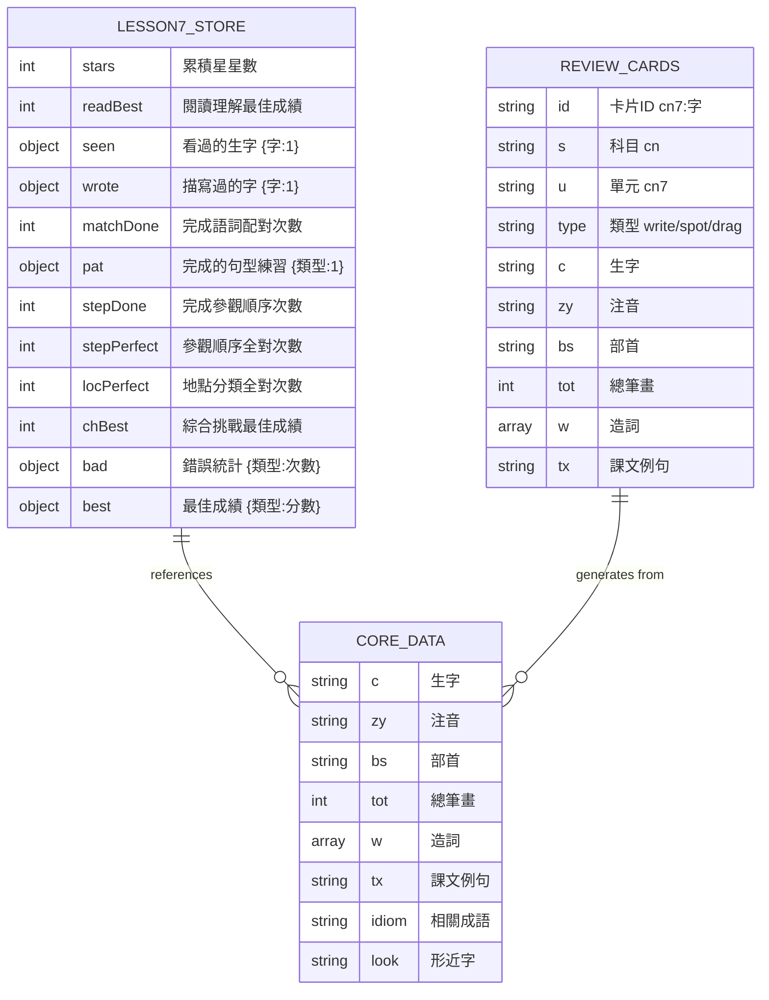

# 國語第七課《到此「藝」遊》系統設計

## 類別圖 (Class Diagram)



## 資料流程圖 (Data Flow)



## 狀態機圖 (State Machine) - 測驗流程



## 循環圖 (Sequence) - 參觀順序排列流程



## UseCase 圖 (Use Case)



## 資料庫設計 (Database DD / ER Model)

本系統使用前端 **localStorage** 儲存，無後端資料庫。

### localStorage 資料結構



### localStorage Key

- **zhArtTourV1**: 第七課學習進度和統計
- **studyReviewV1**: 全站複習系統（未更動）
- **studyBackupAt**: 備份時間戳（未更動）

## 系統架構說明

### 前端技術棧
- **HTML5**: 語意化標籤、Canvas API（描寫板）
- **CSS3**: Flexbox/Grid 響應式佈局、動畫效果
- **Vanilla JavaScript**: 無框架、純原生 JS
- **Web Speech API**: 語音播報功能
- **Web Audio API**: 答題音效
- **localStorage**: 客戶端資料持久化

### 核心模組

1. **Core 模組** (`index.html <script id="core">`)
   - 資料定義：生字、詞語、題目
   - 工具函數：洗牌、隨機選取、檢查答案

2. **App 模組** (`app.js`)
   - 狀態管理：localStorage 讀寫
   - 互動邏輯：點擊、拖曳事件
   - 視覺回饋：星星動畫、音效、語音

3. **測驗系統** (`runQuiz`)
   - 通用測驗框架
   - 進度追蹤
   - 成績計算

4. **遊戲模組**
   - 參觀順序排列 (`startStep`)
   - 地點分類 (`startSort`)
   - 語詞配對 (`startMatch`)

### 設計模式

- **模組化**: Core 和 App 分離，職責清晰
- **工廠模式**: `runQuiz` 生成各種測驗
- **狀態模式**: 測驗流程的狀態轉換
- **策略模式**: 不同題型的判斷邏輯

### 響應式設計

- 基準寬度：390px (iPhone 12 mini)
- 最大寬度：1000px (桌面)
- 字體：clamp() 動態縮放
- 佈局：Grid auto-fit 自適應

### 無障礙設計

- 語意化 HTML 標籤
- ARIA labels 生字按鈕
- 鍵盤導航支援（按鈕 focus）
- 高對比度色彩搭配

## 檔案結構

```
chinese/lesson7-art-tour/
├── index.html          # 主頁面（含 Core 模組）
├── app.js              # 應用邏輯
└── lesson7.md          # 本文檔（Mermaid 圖表）
```

## 複習系統整合

本課程整合到 `review/bank.js` 複習題庫：

### 卡片類型
1. **write** - 看注音寫國字（15 張）
   - ID: `cn7:育`, `cn7:晴`, ...
   - 主動回想，無選項

2. **spot** - 改錯字（5 張）
   - ID: `cnx7:晴:睛`, `cnx7:陶:淘`, ...
   - 點出句子中的錯字

3. **drag** - 部件拼字（4 張）
   - ID: `cnd:晴`, `cnd:陶`, ...
   - 拖曳部首和部件拼字

### 複習演算法

- **間隔重複**: 答對隔 2, 4, 7, 14, 30 天
- **交錯練習**: 國語、數學、自然混合出題
- **錯題強化**: 答錯隔天再來、變成小怪物

## 教學設計原則

✅ **課本內容優先**: 南一版四上第七課  
✅ **主動回想**: Canvas 描寫、部件拼字無選項  
✅ **立即回饋**: 答對/答錯動畫、音效、說明  
✅ **情境學習**: 遊記路線、地點分類體驗空間感  
✅ **遊戲化**: 參觀順序排列、地點分類挑戰  
✅ **記憶樹整合**: 生字卡片進入複習系統

## 資料來源與引用

- 南一版國語四上第七課課本
- [Like創思拾光書坊教案](https://likethinking.com/blog/guo-wen-nanyi-4017)
- 北新國小黃崇劭老師教案
- 教育部筆順學習網（外部連結）
