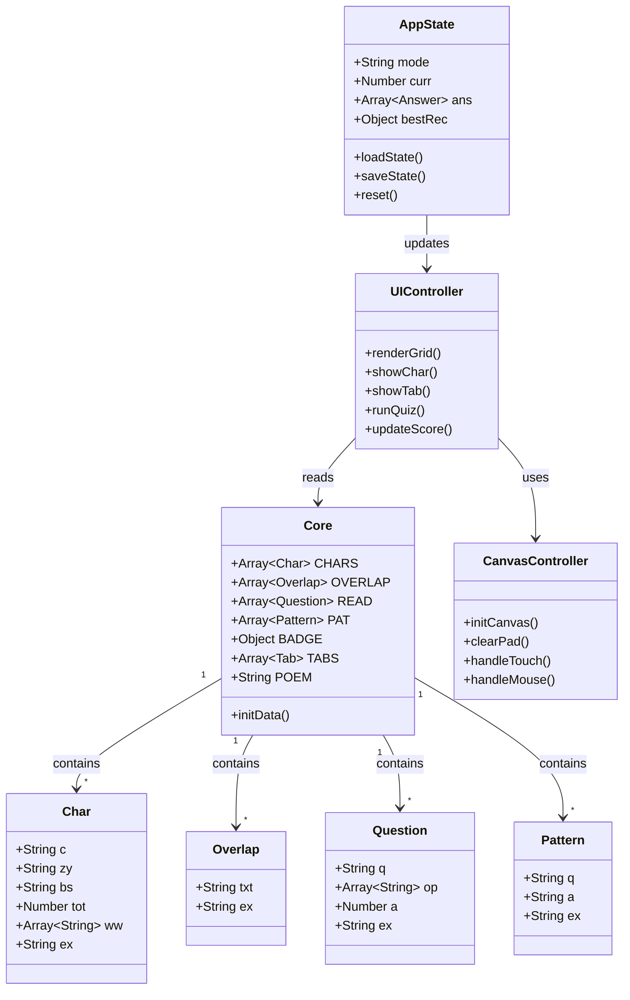
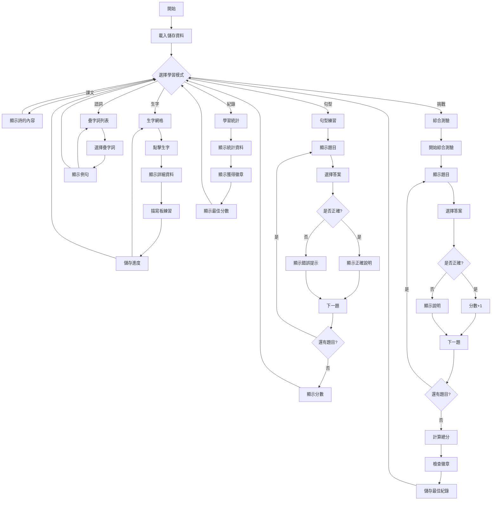
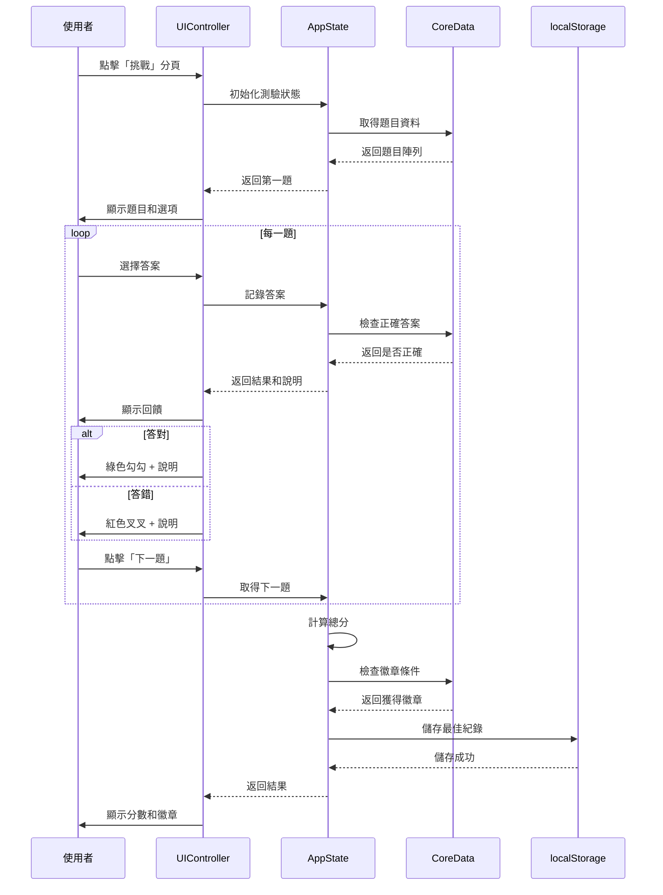
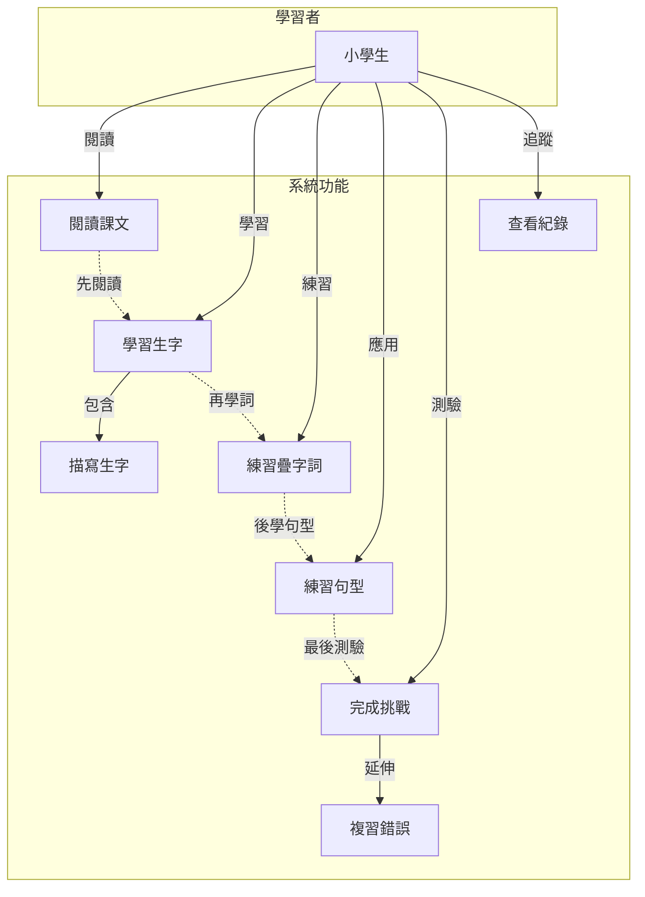
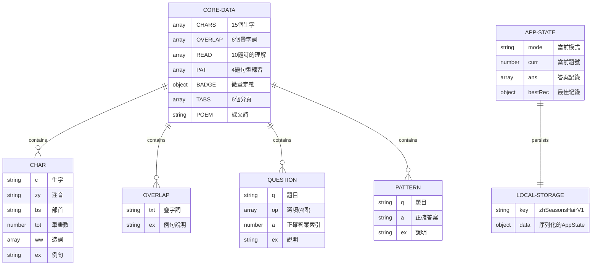
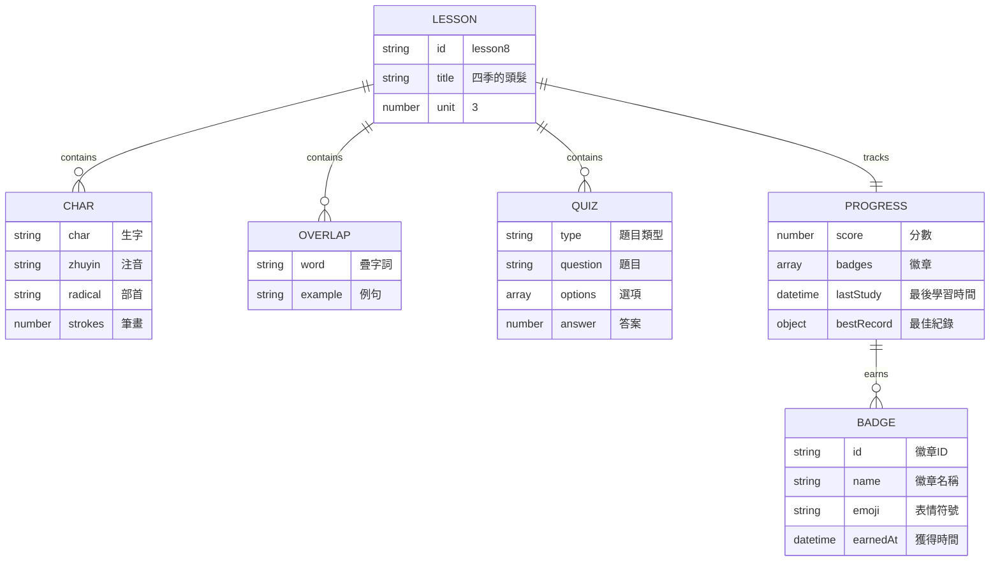
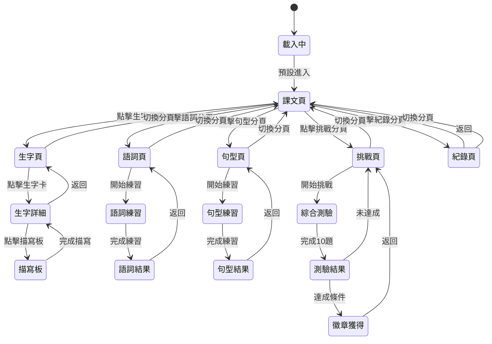

# 第八課「四季的頭髮」技術文件

## 系統架構

### 類別圖 (Class Diagram)



### 流程圖 (Flowchart) - 學習流程



### 循環圖 (Sequence Diagram) - 答題互動



### Use Case 圖



### 資料結構 (Database DD)



### ER Model - 學習紀錄關聯



## 狀態管理

### 狀態轉換圖



## 技術實作細節

### 主要檔案

1. **index.html**
   - 定義 Core 資料物件
   - 包含課文、生字、語詞、句型、測驗資料
   - 定義徽章系統規則
   - HTML 結構 (6 個分頁)

2. **app.js**
   - 狀態管理 (localStorage: zhSeasonsHairV1)
   - UI 控制器
   - Canvas 描寫板邏輯
   - 測驗邏輯
   - 分數計算
   - 徽章檢查

### localStorage 資料結構

```javascript
{
  "mode": "poem|chars|overlap|pattern|quiz|rec",
  "curr": 0,
  "ans": [],
  "bestRec": {
    "score": 10,
    "badges": ["詩人", "觀察家", "語言大師", "四季通"],
    "date": "2026-11-18T10:30:00.000Z"
  }
}
```

### 徽章系統

| 徽章 | 條件 | 符號 |
|------|------|------|
| 詩人 | 詩的理解全對 | 📖 |
| 觀察家 | 生字題全對 | 🔍 |
| 語言大師 | 疊字詞題全對 | 💬 |
| 四季通 | 挑戰滿分 | 🌟 |

### 題目類型

1. **生字題** (3題): 從課文句子選出正確的生字
2. **疊字詞題** (2題): 選擇正確的疊字詞填空
3. **句型題** (2題): 「不得不」句型應用
4. **詩理解題** (3題): 理解詩的內容和意象

### 分頁結構

```
┌─────────────────────────────┐
│  課文 生字 語詞 句型 挑戰 紀錄 │
├─────────────────────────────┤
│                             │
│        [當前分頁內容]         │
│                             │
│                             │
└─────────────────────────────┘
```

## 響應式設計

- 最小寬度: 390px (iPhone 12 Pro)
- 中等寬度: 768px (iPad)
- 大螢幕: 1024px+ (桌面)

## 未來擴充

1. **語音功能**: 播放生字發音
2. **動畫效果**: 筆順動畫
3. **社交功能**: 分享學習成果
4. **進階分析**: 學習曲線圖表
5. **錯題本**: 自動收集錯誤題目

---

**建立日期**: 2026-11-18  
**版本**: 1.0  
**南一版**: 四年級上冊 第八課
