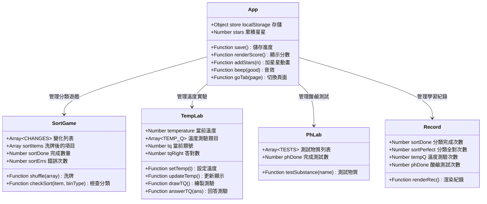
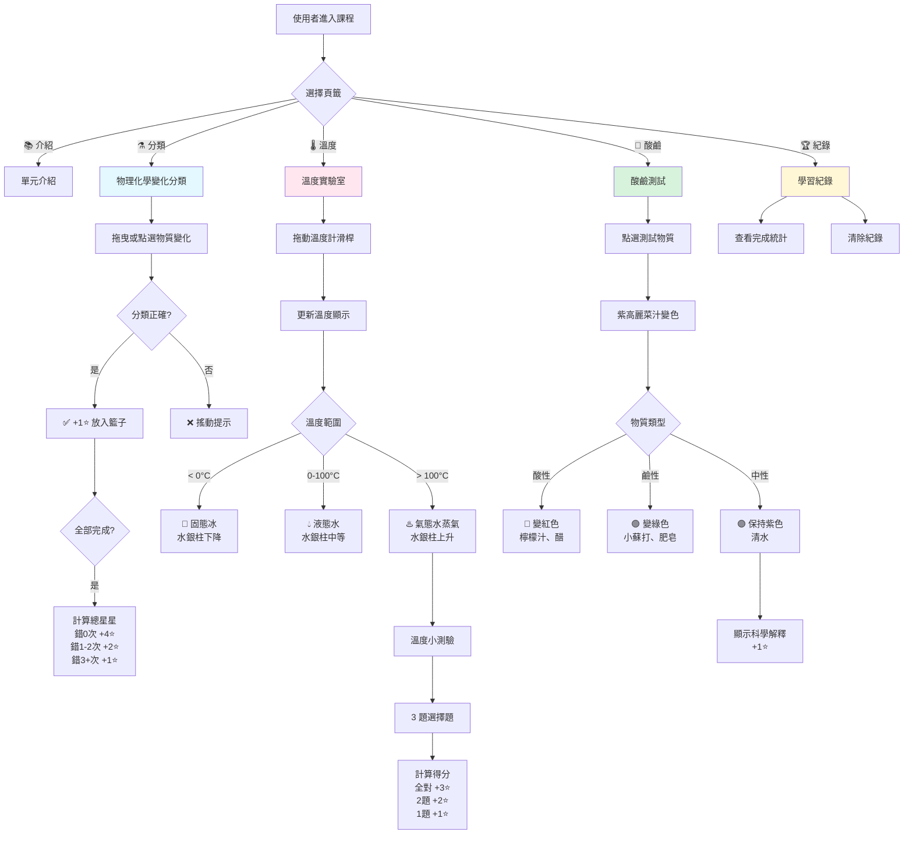
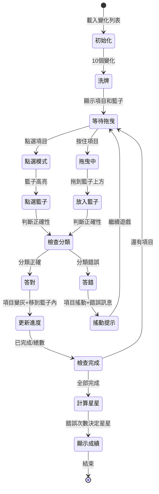
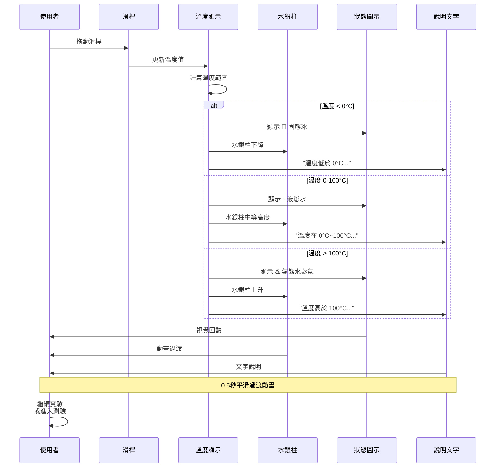
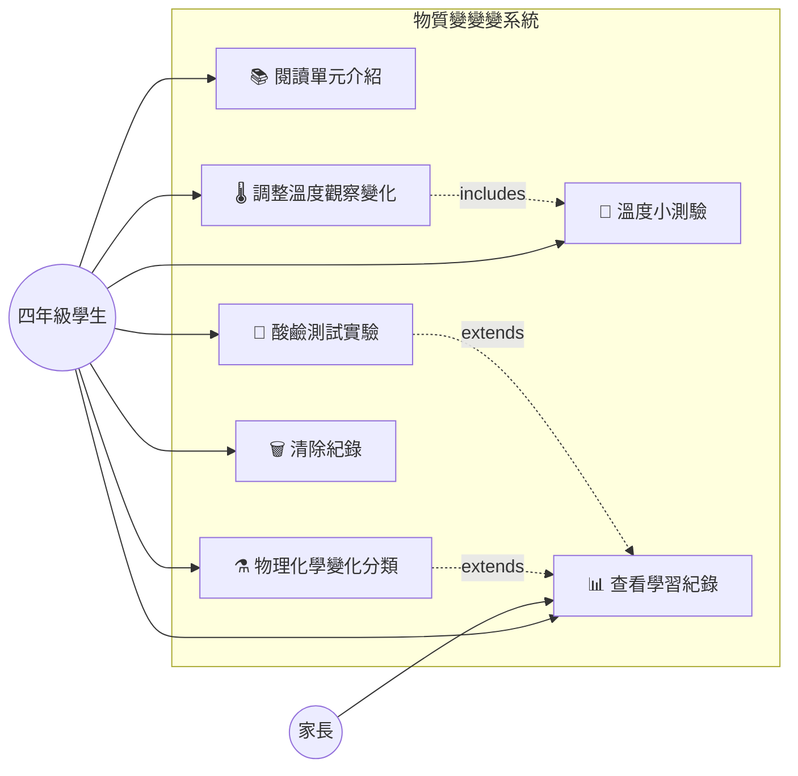
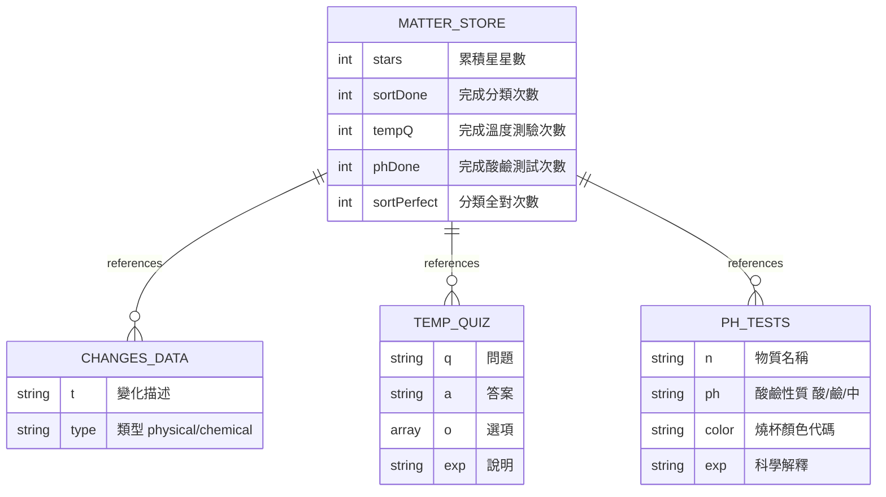
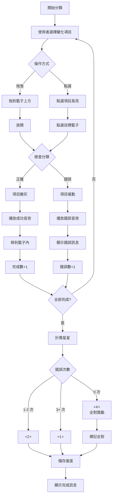

# 自然第三單元《物質變變變》系統設計

## 類別圖 (Class Diagram)



## 資料流程圖 (Data Flow)



## 狀態機圖 (State Machine) - 分類遊戲流程



## 循環圖 (Sequence) - 溫度實驗互動流程



## UseCase 圖 (Use Case)



## 資料庫設計 (Database DD / ER Model)

本系統使用前端 **localStorage** 儲存，無後端資料庫。

### localStorage 資料結構



### localStorage Key

- **natureMatterV1**: 第三單元學習進度和統計

### 資料項目

**物理化學變化 (CHANGES)**
```javascript
[
  {t:"冰塊融化成水", type:"physical"},
  {t:"木頭燃燒", type:"chemical"},
  // ... 共 10 個
]
```

**溫度測驗 (TEMP_Q)**
```javascript
[
  {
    q:"冰塊放在室溫下會融化成水，這是什麼變化？",
    a:"物理變化",
    o:["物理變化","化學變化"],
    exp:"冰融化成水是物理變化，因為可以再結冰回來。"
  },
  // ... 共 3 題
]
```

**酸鹼測試物質 (TESTS)**
```javascript
[
  {
    n:"檸檬汁",
    ph:"酸",
    color:"#ff9fb8",
    exp:"檸檬汁含檸檬酸，是酸性（pH < 7）。"
  },
  // ... 共 5 種
]
```

## 流程圖 (Flowchart) - 分類判斷邏輯



## 系統架構說明

### 前端技術棧
- **HTML5**: 語意化標籤、range input（溫度滑桿）
- **CSS3**: 
  - Flexbox/Grid 響應式佈局
  - CSS Variables（顏色主題）
  - transition/animation（平滑過渡、搖動效果）
- **Vanilla JavaScript**: 無框架、純原生 JS
- **Web Audio API**: 答題音效
- **localStorage**: 客戶端資料持久化
- **Drag and Drop API**: 拖曳互動

### 核心模組

1. **資料模組**
   - `CHANGES`: 10 個物理化學變化
   - `TEMP_Q`: 3 題溫度測驗
   - `TESTS`: 5 種酸鹼測試物質

2. **遊戲邏輯**
   - `checkSort`: 分類判斷
   - `updateTemp`: 溫度更新
   - `testSubstance`: 酸鹼測試

3. **狀態管理**
   - localStorage 讀寫
   - 星星計算與動畫
   - 進度追蹤

4. **視覺回饋**
   - 音效（beep）
   - 動畫（shake, pop, transition）
   - 顏色變化（燒杯、水銀柱）

### 設計模式

- **事件驅動**: drag/drop, click, input 事件
- **狀態模式**: 溫度範圍判斷（< 0, 0-100, > 100）
- **策略模式**: 分類檢查、星星計算邏輯
- **觀察者模式**: 溫度滑桿 input 事件監聽

### 響應式設計

- 基準寬度：390px (iPhone 12 mini)
- 最大寬度：1000px (桌面)
- 字體：clamp() 動態縮放
- 滑桿：100% 寬度適應

### 互動設計

- **雙操作模式**: 拖曳 + 點選（考慮觸控設備）
- **視覺提示**: 籃子高亮（dragover）
- **即時回饋**: 搖動動畫、音效、訊息
- **平滑過渡**: 0.5s transition（顏色、高度）

## 檔案結構

```
nature/matter-changes/
├── index.html          # 完整互動頁面（含 CSS 和 JS）
└── matter.md           # 本文檔（Mermaid 圖表）
```

## 複習系統整合

本課程已加入 `review/bank.js`:
- 單元代碼: `na3`
- 名稱: 第三單元 物質變變變
- 連結: `nature/matter-changes/`

**未來可擴展複習卡片**:
- `pick` 類型：判斷物理/化學變化
- `pick` 類型：溫度範圍選擇
- `pick` 類型：酸鹼性判斷

## 教學設計原則

✅ **課本內容優先**: 翰林版四上第三單元  
✅ **動手操作**: 拖曳、滑動、點選，0% 純文字  
✅ **立即回饋**: 視覺變化、動畫、音效、文字說明  
✅ **生活化例子**: 冰融化、木頭燒、肥皂水  
✅ **科學解釋**: 每個實驗都有原理說明  
✅ **自主探索**: 自由調整溫度、隨意測試物質  
✅ **成就感**: 星星獎勵、完成統計

## 科學內容說明

### 物理變化 vs 化學變化

| 物理變化 | 化學變化 |
|---------|---------|
| 外形改變，本質不變 | 產生新物質 |
| 可以恢復原狀 | 無法恢復原狀 |
| 例：冰融化、紙撕破 | 例：木頭燒、鐵生鏽 |

### 水的三態變化

- **固態（冰）**: 0°C 以下
- **液態（水）**: 0°C ~ 100°C
- **氣態（水蒸氣）**: 100°C 以上
- 三態之間可互相轉換（物理變化）

### 酸鹼指示劑

**紫高麗菜汁**是天然指示劑：
- **酸性（pH < 7）**: 變紅色（檸檬汁、醋）
- **中性（pH = 7）**: 保持紫色（清水）
- **鹼性（pH > 7）**: 變綠/黃色（小蘇打、肥皂）

## 資料來源與引用

- 翰林版自然四上第三單元課本
- 課本第1課：影響物質變化的因素
- 課本第2課：溫度對物質的影響
- 課本第3課：酸與鹼對物質的影響
