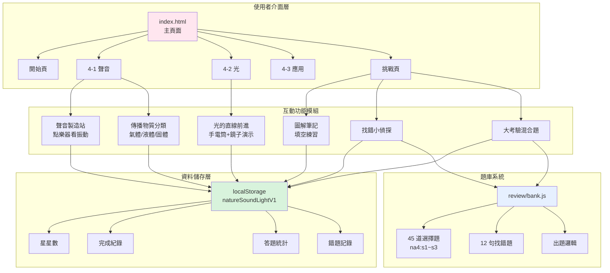
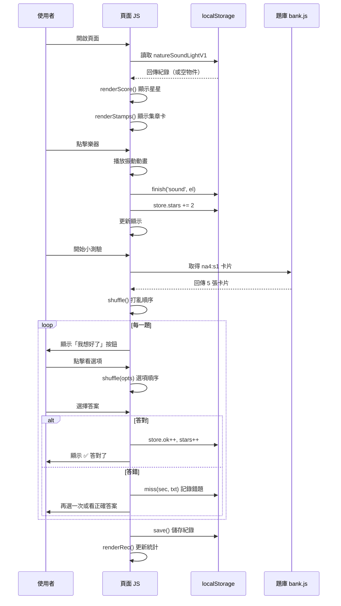
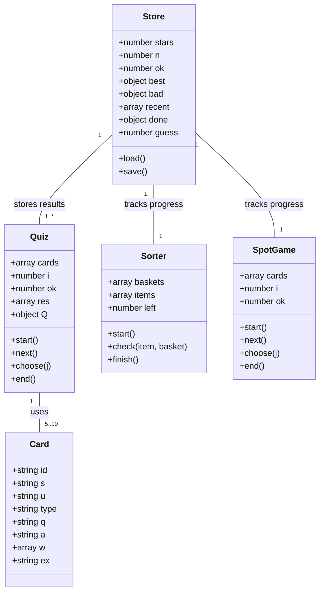
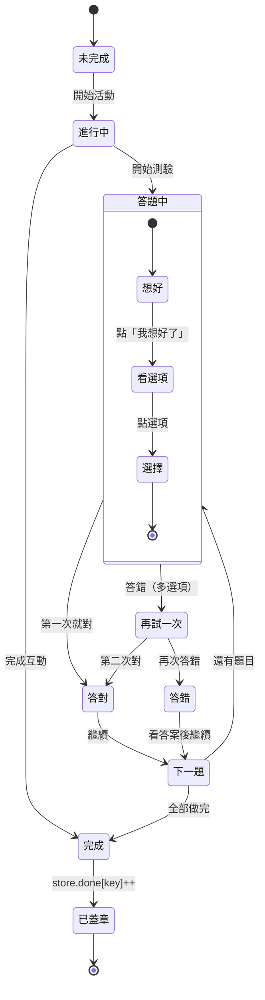
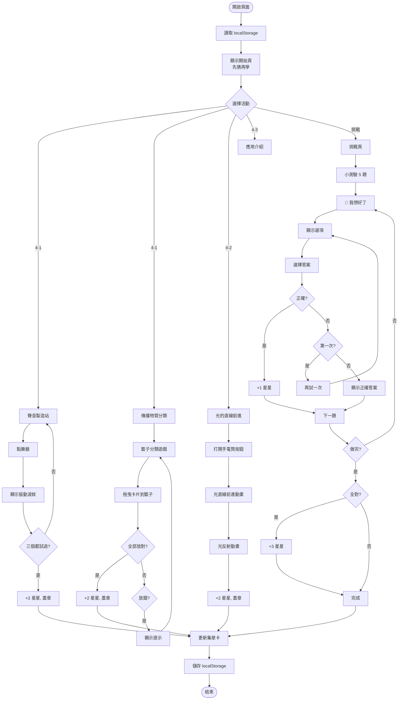
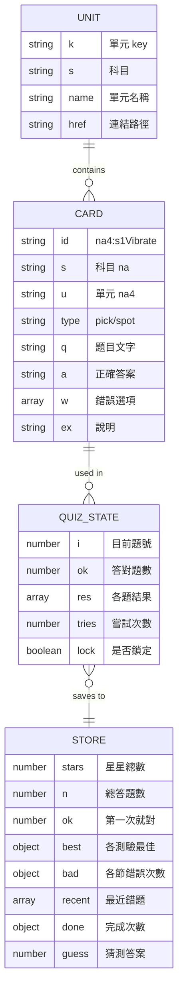
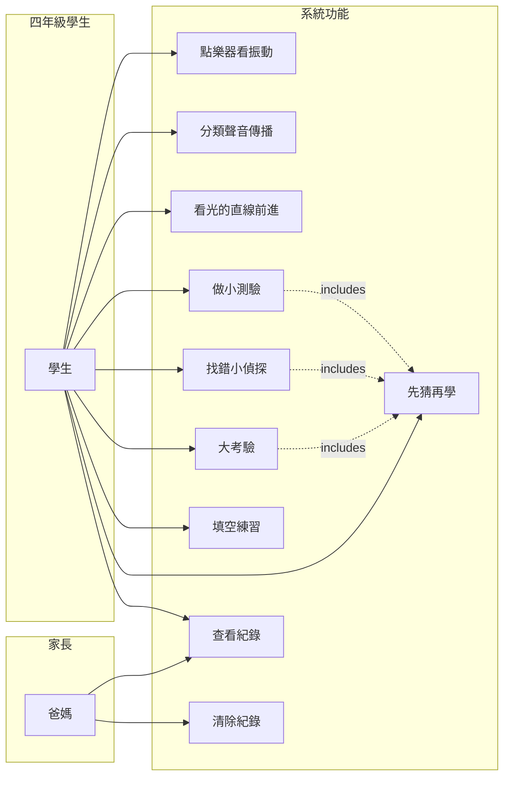
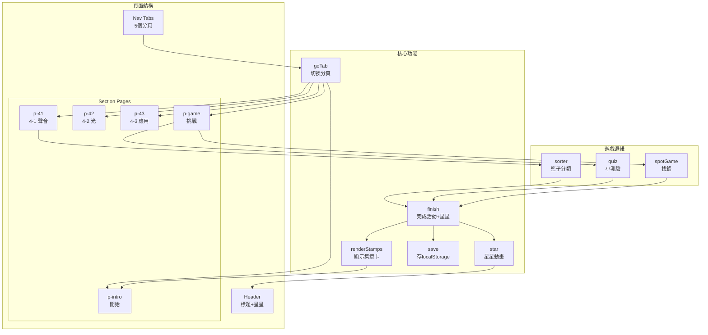
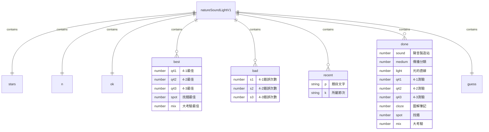

# 聲光世界真有趣 - 系統設計文件

翰林版自然 4上 第四單元（課本 p.98～123）

## 系統架構圖



## 資料流程圖



## 類別結構圖



## 狀態機圖



## 活動流程圖



## 複習卡片資料結構



## 使用案例圖



## 元件互動圖



## 資料庫 ER Model（localStorage）



## 核心演算法流程

### 籃子分類遊戲演算法

```mermaid
flowchart TD
    Start([開始遊戲]) --> Init[初始化:<br/>left=items.length<br/>sel=null]
    Init --> Shuffle[打亂卡片順序]
    Shuffle --> Render[渲染卡片和籃子]
    
    Render --> Wait1{等待操作}
    Wait1 -->|點卡片| SelectCard[sel=i<br/>卡片標記.on]
    Wait1 -->|點籃子| CheckSel{sel !== null?}
    
    SelectCard --> Wait1
    
    CheckSel -->|否| ShowTip1[提示:<br/>先點卡片]
    ShowTip1 --> Wait1
    
    CheckSel -->|是| Match{items[sel][1]<br/>== k?}
    
    Match -->|是| Correct[移除卡片<br/>加到籃子<br/>left--]
    Match -->|否| Wrong[卡片和籃子<br/>shake 動畫]
    
    Correct --> CheckDone{left == 0?}
    CheckDone -->|否| Wait1
    CheckDone -->|是| Finish[顯示完成<br/>finish(key)]
    
    Wrong --> Wait1
    Finish --> End([結束遊戲])
```

### 小測驗答題邏輯

```mermaid
flowchart TD
    Start([開始測驗]) --> LoadCards[從 bank.js<br/>取得卡片]
    LoadCards --> Check{有題目?}
    Check -->|否| Error[顯示錯誤]
    Check -->|是| Init[S.i=0, S.ok=0]
    
    Init --> NextQ[next()]
    NextQ --> End1{i >= cards.length?}
    End1 -->|是| ShowResult[顯示結果<br/>全對+3星]
    
    End1 -->|否| PrepQ[準備第i題<br/>打亂選項<br/>S.tries=0]
    PrepQ --> ShowThink[顯示:<br/>💭我想好了]
    ShowThink --> Wait{等待點擊}
    Wait --> ShowOpts[顯示選項]
    ShowOpts --> WaitAns{等待選擇}
    
    WaitAns --> Choose[choose(j)]
    Choose --> Match{j == Q.a?}
    
    Match -->|是| First1{tries==0?}
    First1 -->|是| AddOk[store.ok++<br/>S.ok++<br/>+1星]
    First1 -->|否| NoStar[不加星]
    AddOk --> MarkGood[S.res[i]=1]
    NoStar --> MarkOk[S.res[i]=0]
    MarkGood --> ShowRight[顯示✅答對]
    MarkOk --> ShowRight
    
    Match -->|否| Inc[S.tries++<br/>miss(sec,txt)]
    Inc --> First2{tries==1<br/>且opts>2?}
    First2 -->|是| Retry[提示再試一次]
    First2 -->|否| ShowAns[顯示正確答案<br/>S.res[i]=0]
    
    Retry --> WaitAns
    ShowRight --> NextBtn[下一題按鈕]
    ShowAns --> NextBtn
    NextBtn --> IncI[S.i++]
    IncI --> NextQ
    
    ShowResult --> FinishQuiz[finish(key)]
    FinishQuiz --> End([結束測驗])
    Error --> End
```

## 星星獎勵機制

| 動作 | 星星數 | 觸發條件 |
|------|--------|----------|
| 完成互動活動 | +2 | finish(key) 首次完成 |
| 小測驗答對一題 | +1 | 第一次就選對 |
| 小測驗全對 | +3 | bonus 獎勵 |
| 找錯答對一句 | +1 | 第一次就找對 |
| 大考驗全對 | +3 | bonus 獎勵 |

## 技術規格

### 前端技術
- 純 HTML + CSS + JavaScript（Vanilla JS，無框架）
- localStorage 儲存紀錄
- CSS 動畫（振動、波紋、星星爆炸）
- RWD 設計（最小支援 390px 寬度）
- 無障礙屬性（aria-label）

### 瀏覽器支援
- localStorage API
- CSS Grid / Flexbox
- ES5+ JavaScript
- SVG 動畫

### 效能考量
- 圖片使用 Emoji（無需載入外部圖檔）
- localStorage 容量限制（約 5MB）
- 動畫使用 CSS transform（硬體加速）
- 題目即時產生（不預先載入全部）

## 相依性

### 外部相依
- `../../review/bank.js` - 題庫系統
- `../` - 返回自然首頁
- `../quest/` - 闖關地圖（尚未整合）
- `../../review/` - 今天的複習

### 內部模組相依
- 互動活動 → localStorage
- 小測驗 → bank.js + localStorage
- 集章系統 → 所有活動 + localStorage
- 星星系統 → finish() + star()

## 未來擴充方向

1. **整合闖關地圖**
   - 將第四單元加入 nature/quest/
   - 需重新設計地圖佈局（目前只有前兩單元）

2. **增加互動性**
   - 聲音播放功能（實際樂器聲）
   - 光的反射可調整角度
   - 更多動物聲音的互動

3. **記錄擴充**
   - 每題答題時間紀錄
   - 學習曲線圖表
   - 匯出學習報告

4. **題目擴充**
   - 科學閱讀「萬花筒」的互動實作
   - 更多找錯題
   - 開放式問答題
