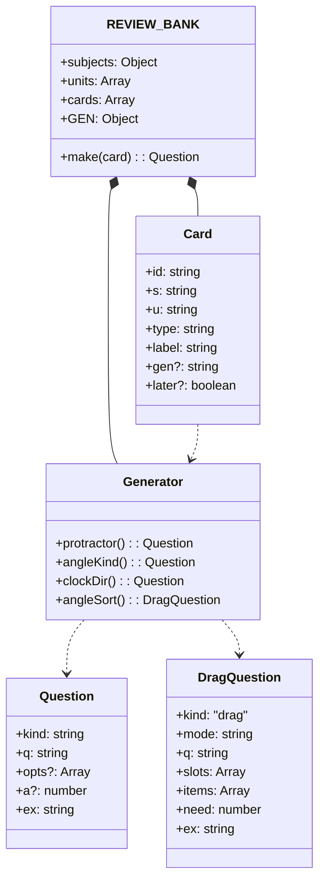
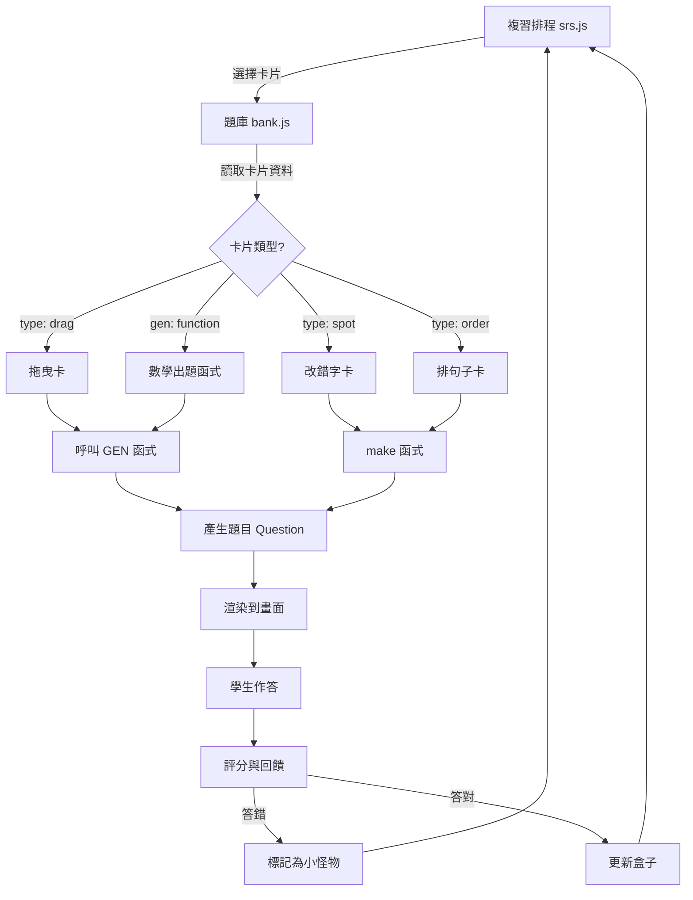
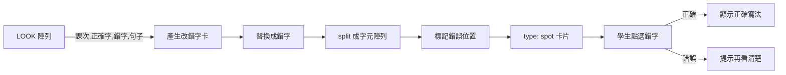
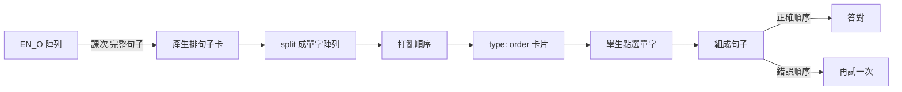
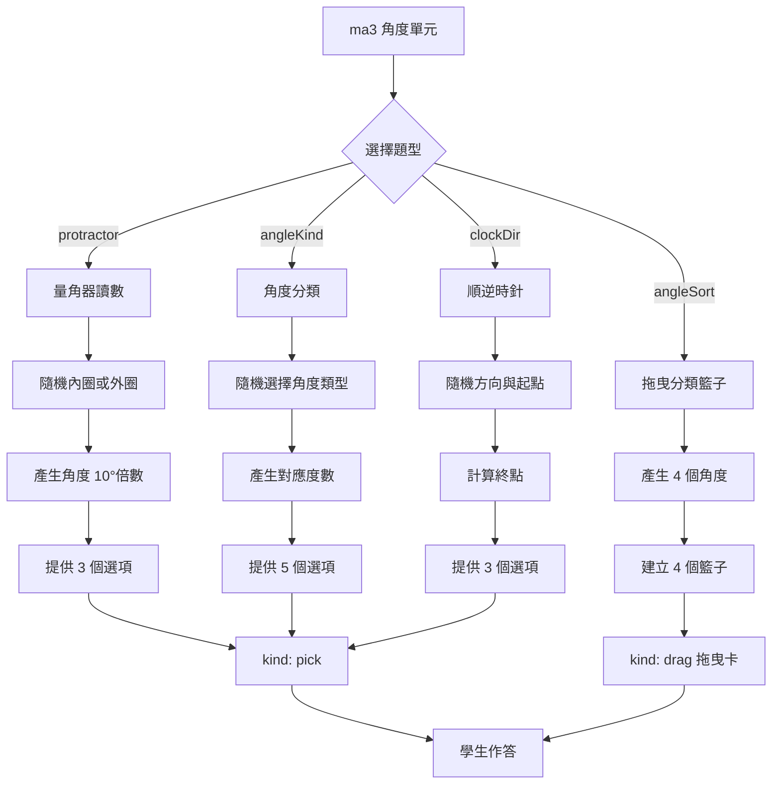
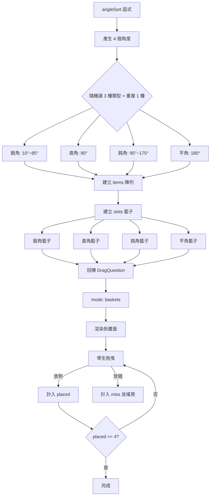
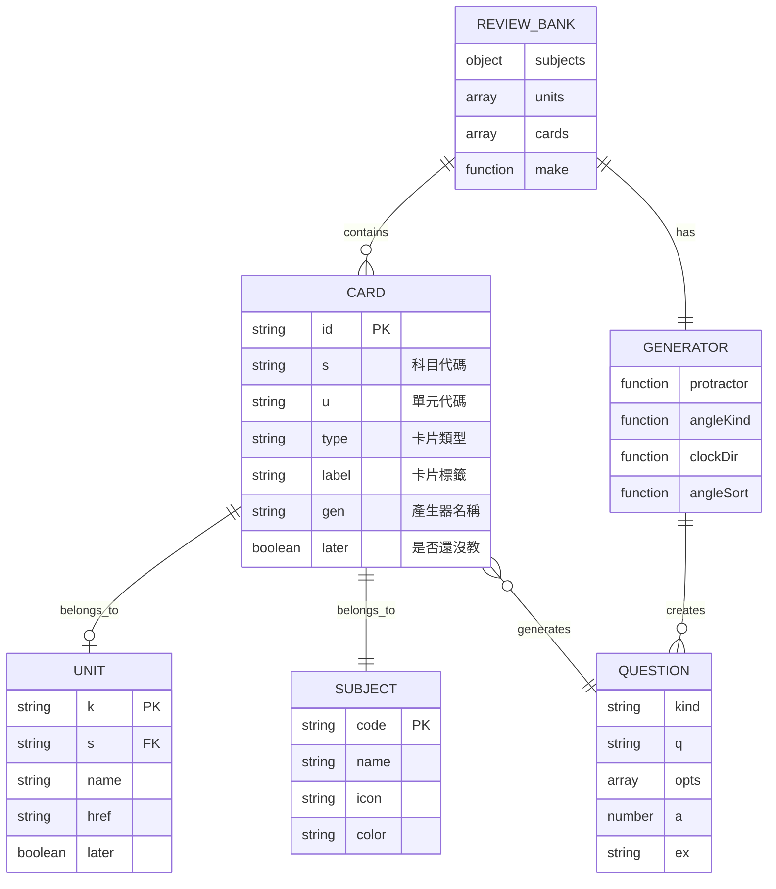
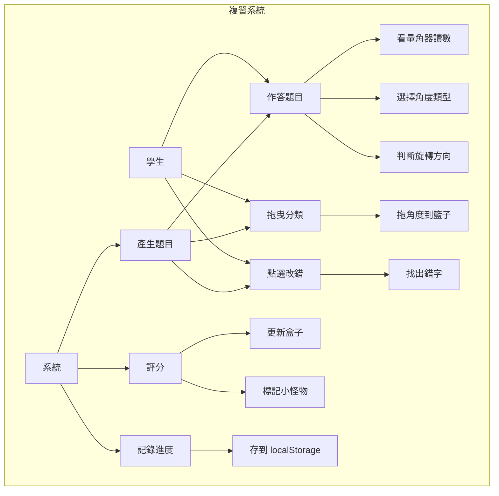
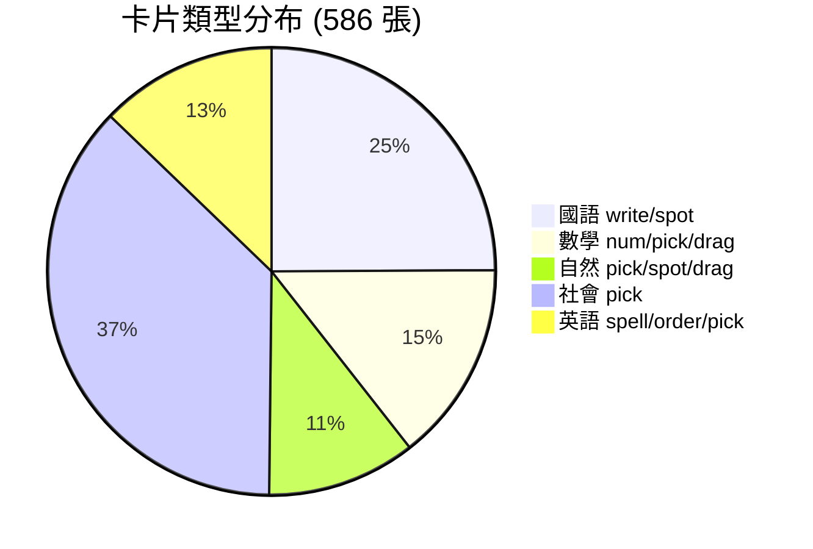

# 今天的複習：題庫改進（bank.js）

本次更新日期：2026-11-10

## 改進概述

本次更新針對瑄瑄在學習中的弱點，新增了兩類複習卡片：

1. **國語形近字改錯**：新增氣/棄的混淆字卡 4 張
2. **英語時間表達**：新增 half past / quarter 句子排序 3 張
3. **數學角度單元**：新增 4 種新題型（量角器、角度分類、順逆時針、拖曳分類）

---

## 類別圖（Class Diagram）



---

## 資料流程圖（Data Flow）



---

## 新增功能流程圖

### 1. 國語改錯字卡流程



新增 4 張氣/棄混淆字卡：
- 第 1 課：充滿藝術**氣**息（易錯：棄）
- 第 2 課：今天的天**氣**很好（易錯：汽）
- 第 3 課：有勇**氣**上臺表演（易錯：棄）
- 第 5 課：不輕言放**棄**（易錯：氣）

### 2. 英語排句子卡流程



新增 3 張 half past / quarter 句子：
- It's **half past** four.（4:30）
- It's **a quarter past** six.（6:15）
- It's **a quarter to** seven.（6:45）

### 3. 數學角度題型流程



---

## 拖曳卡架構圖



---

## ER 模型（Entity-Relationship）



---

## 使用案例圖（Use Case）



---

## 資料字典（Data Dictionary）

### 新增的 LOOK 條目

| 欄位 | 類型 | 說明 | 範例 |
|------|------|------|------|
| [0] | number | 課次 | 1, 2, 3, 5 |
| [1] | string | 正確的字 | "氣", "棄" |
| [2] | string | 形近字（錯字） | "棄", "氣", "汽" |
| [3] | string | 課文句子 | "充滿藝術氣息" |

### 新增的 EN_O 條目

| 欄位 | 類型 | 說明 | 範例 |
|------|------|------|------|
| [0] | number | 課次 | 2 |
| [1] | string | 完整句子 | "It's half past four." |

### 新增的數學卡片

| 單元 | 函式名 | 標籤 | 類型 |
|------|--------|------|------|
| ma3 | protractor | 量角器內外圈 | pick |
| ma3 | angleKind | 角度分類 | pick |
| ma3 | clockDir | 順時針與逆時針 | pick |
| ma3 | angleSort | 角度分類籃子 | drag |

---

## 統計資料

### 更新前後卡片數量對比

| 科目 | 更新前 | 更新後 | 新增 |
|------|--------|--------|------|
| 國語 | 142 | 146 | +4 |
| 數學 | 81 | 85 | +4 |
| 自然 | 63 | 63 | 0 |
| 社會 | 217 | 217 | 0 |
| 英語 | 72 | 75 | +3 |
| **總計** | **575** | **586** | **+11** |

### 卡片類型分布



---

## 實作細節

### 1. 量角器讀數 (protractor)

**產生邏輯**：
- 隨機選擇外圈或內圈（50% 機率）
- 產生 20°~170° 的角度（10° 的倍數）
- 外圈且 >= 100° 時，取補角（180 - d）
- 提供正確答案 + 2 個干擾選項

**驗證規則**：
- 答案範圍：20° ~ 170°（10° 倍數）
- 外圈：直接讀外圈數字
- 內圈：180 - 外圈數字

### 2. 角度分類 (angleKind)

**分類標準**（依康軒課本）：
- 銳角：5° ~ 85°（5° 倍數）
- 直角：90°
- 鈍角：95° ~ 175°（5° 倍數）
- 平角：180°
- 周角：360°

**產生邏輯**：
- 隨機選擇一種類型
- 產生對應範圍的角度
- 提供 5 個選項讓學生選擇

### 3. 順逆時針 (clockDir)

**產生邏輯**：
- 隨機起點（1~12）
- 隨機方向（順時針或逆時針）
- 隨機步數（2, 3, 4, 6 格）
- 計算終點位置

**驗證規則**：
- 順時針：照時鐘指針方向（from + steps）
- 逆時針：反時鐘方向（from - steps）
- 結果需 mod 12 處理循環

### 4. 角度分類籃子 (angleSort)

**產生邏輯**：
- 從 4 種類型中隨機選 3 種
- 再隨機重複其中 1 種，共 4 個角度
- 每種類型產生對應範圍的角度

**拖曳規則**：
- mode: 'baskets' 表示籃子模式
- 可以拖曳或點選
- 放錯會搖晃並提示
- 全部放對才完成

---

## 測試案例

### 量角器測試

```javascript
// 測試 10 次，確保：
// 1. 答案在 20°~170° 範圍
// 2. 都是 10° 的倍數
// 3. 有內外圈兩種情況
for (var i = 0; i < 10; i++) {
  var q = GEN.protractor();
  assert(q.kind === 'pick');
  assert(q.opts.length === 3);
  var ans = parseInt(q.opts[q.a]);
  assert(ans >= 20 && ans <= 170);
  assert(ans % 10 === 0);
}
```

### 角度分類測試

```javascript
// 測試 50 次，確保所有類型都有出現
var types = {};
for (var i = 0; i < 50; i++) {
  var q = GEN.angleKind();
  types[q.opts[q.a]] = true;
}
assert(types['銳角'] && types['直角'] && types['鈍角'] && types['平角'] && types['周角']);
```

### 拖曳卡測試

```javascript
// 測試 20 次，確保：
// 1. 產生 4 個角度
// 2. 角度與 slot 匹配正確
// 3. 包含至少 2 種不同類型
for (var i = 0; i < 20; i++) {
  var q = GEN.angleSort();
  assert(q.items.length === 4);
  assert(q.slots.length === 4);
  q.items.forEach(function(item) {
    var deg = item.deg;
    var slot = item.slot;
    if (deg < 90) assert(slot === '銳角');
    else if (deg === 90) assert(slot === '直角');
    else if (deg < 180) assert(slot === '鈍角');
    else if (deg === 180) assert(slot === '平角');
  });
}
```

---

## 課本對照

所有新增內容都嚴格對照課本：

### 國語（南一 4 上）

| 卡片 | 課次 | 課文出處 | 驗證 |
|------|------|----------|------|
| 氣/棄 | 第 1 課 | "充滿藝術氣息" | ✓ 課文第 3 段 |
| 氣/汽 | 第 2 課 | "今天的天氣很好" | ✓ 練習單形近字 |
| 氣/棄 | 第 3 課 | "有勇氣上臺表演" | ✓ 課文造句 |
| 棄/氣 | 第 5 課 | "不輕言放棄" | ✓ 課文第 2 段 |

### 英語（康軒 Wonder World 3）

| 卡片 | 單元 | 複習頁出處 | 驗證 |
|------|------|------------|------|
| half past | Unit 2 | review1/index.html line 230 | ✓ |
| quarter past | Unit 2 | review1/index.html line 231 | ✓ |
| quarter to | Unit 2 | review1/index.html line 232 | ✓ |

### 數學（康軒 4 上 第三單元）

| 題型 | 課本內容 | 驗證 |
|------|----------|------|
| 量角器內外圈 | 3-1 量角器的認識與報讀 | ✓ |
| 銳角/直角/鈍角/平角/周角 | 3-3 旋轉角 | ✓ |
| 順時針/逆時針 | 3-3 旋轉角 | ✓ |

---

## 待辦事項與已知限制

### ✅ 已完成
- [x] 國語：新增 4 張氣/棄混淆字卡
- [x] 英語：新增 3 張 half past/quarter 句子
- [x] 數學：新增量角器讀數題
- [x] 數學：新增角度分類題
- [x] 數學：新增順逆時針題
- [x] 數學：新增角度拖曳籃子
- [x] 更新卡片總數統計

### ⚠️ 無法驗證的項目
- 量角器題目中的「指針對準刻度」圖示（需要實際課本確認刻度標示方式）
- 所有新題型的實際難度是否適合四年級學生（需要實測）

### 💡 未來改進方向
- 可考慮為量角器題添加視覺化的量角器圖示
- 順逆時針題可以加上鐘面動畫
- 角度拖曳籃子可以加上即時視覺回饋（顯示角度圖形）

---

## 維護注意事項

### 不可變動的項目（硬約束）
1. ❌ **不可更改現有卡片 id**：會導致學生進度遺失
2. ❌ **不可修改 srs.js 排程規則**
3. ❌ **不可更改 localStorage 鍵名**（studyReviewV1、studyBackupAt）
4. ❌ **不可刪除或修改現有課文句子**（社會/自然的 pick 卡 id 由題目文字生成）

### 新增卡片檢查清單
- [ ] 確認課本有該內容（不可自創）
- [ ] 使用課本的正確用語（如：挺水性、浮葉性）
- [ ] 測試產生器 100+ 次確認無 NaN/undefined
- [ ] 檢查答案都在選項範圍內
- [ ] 更新 learning-design.md 的卡片總數
- [ ] 標註延伸內容為「🔎 延伸」而非「📖 課本」

---

**文檔版本**: 1.0  
**最後更新**: 2026-11-10  
**對應 commit**: 920b9ff
